<h2 align="center">Olá, eu sou o Tiago</h2>

  <b>Desenvolvedor Full Stack</b> · React · Next.js · Python · AWS 
  Estagiário de Desenvolvimento na Mindworks e estudante de Análise e Desenvolvimento de Sistemas na Unisales

  
  

### Sobre mim

Desenvolvo interfaces com React, Next.js e TypeScript e integrações de back-end em Python com AWS Lambda, APIs REST, webhooks e n8n. Hoje trabalho no chatbot de autoatendimento de TI da Mindworks, do front-end às integrações com AWS, GLPI e Active Directory.

Gosto de investigar falhas a fundo: analisando logs do n8n e do CloudWatch, encontrei e corrigi um fluxo de reset de senha que informava sucesso sem a troca acontecer.

- Trabalhando em: chatbot de autoatendimento de TI com Next.js, n8n e AWS Lambda
- Estudando: testes automatizados e back-end com Java e Spring Boot
- Buscando: vaga de estágio ou júnior como Desenvolvedor Full Stack

### Projetos em destaque

| Projeto | O que é | Tecnologias |
| :--- | :--- | :--- |
| **Assistente Mindworks** *(privado, em produção)* | Chatbot de autoatendimento de TI para chamados, reset de senha, desbloqueio de conta e autenticação em dois fatores. Desenvolvi o front-end, migrei 7 fluxos do Typebot para o n8n, criei a Lambda que abre chamados no GLPI e corrigi a Lambda de reset de senha | Next.js, React, TypeScript, n8n, AWS Lambda (Python), API Gateway |
| [**Site da Anviti Tecnologia**](https://anviti.com.br) · [código](https://github.com/anvititecnologia/anviti-site) | Site institucional responsivo que desenvolvi sozinho, com formulário integrado ao WhatsApp, página LGPD e imagens otimizadas em WebP | Next.js, React, TypeScript, Tailwind CSS |
| [**Site da KL Películas**](https://www.klpeliculas.com.br) | Site com portfólio por categoria, comparação interativa de antes e depois e orçamento pelo WhatsApp | Next.js, React, Vercel |
| [**Schedemy**](https://github.com/tiagutg/schedemy) | Sistema full stack de agendamentos acadêmicos, feito em equipe na faculdade. Participei redesenhando o painel e documentando o projeto | Java, Spring Boot, MySQL, React, TypeScript |

### Tecnologias

**Front-end** 

**Back-end** 

**Banco de dados e nuvem** 
 
AWS: Lambda, API Gateway e CloudWatch

**Automação e ferramentas** 

### Linguagens mais usadas

  

  

